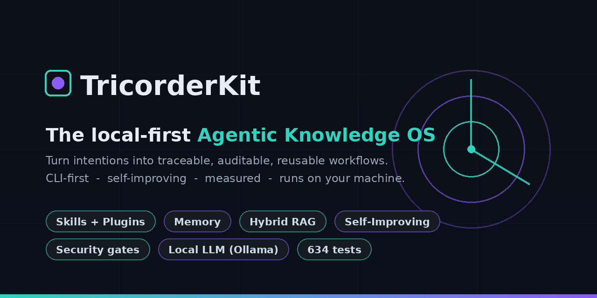
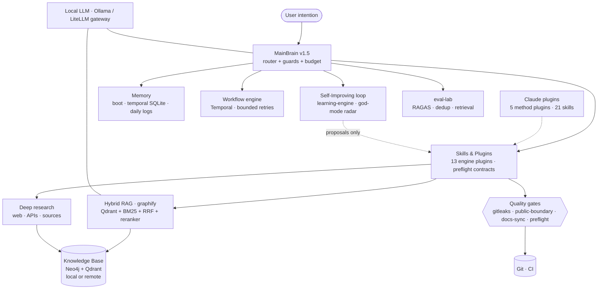

<div align="center">



# TricorderKit

**The local-first Agentic Knowledge OS** — turn intentions into traceable, auditable, reusable workflows.
CLI-first · self-improving · measured · runs on your own machine.

[](CHANGELOG.md)
[](https://github.com/GeekFamilyCorp/TricorderKit/actions/workflows/tests.yml)
[](https://github.com/GeekFamilyCorp/TricorderKit/actions/workflows/gitleaks.yml)
[](https://github.com/GeekFamilyCorp/TricorderKit/actions/workflows/public-boundary.yml)
[](docs/09_GOVERNANCE_GUARDRAILS.md)
[](#-use-it-inside-claude)
[](docker-compose.yml)
[](LICENSE)
[](https://github.com/GeekFamilyCorp/TricorderKit/stargazers)

[What's new](#-whats-new) • [Quick start](#-quick-start) • [Use it inside Claude](#-use-it-inside-claude) • [Guardrails](#%EF%B8%8F-governance--guardrails) • [Architecture](#-architecture) • [Measured results](#-measured-results) • [What's inside](#-whats-inside) • [Docs index](#-documentation-index) • [FAQ](#-faq)

</div>

---

## Why TricorderKit?

Most agent setups are a pile of prompts and scripts that nobody can audit, reproduce, or improve. TricorderKit treats an agent like an **operating system for knowledge work**: every intention becomes a workflow that is **traceable, testable, and reusable** — and the system **measures and improves itself** over time.

|  | Ad-hoc agent setup | **TricorderKit** |
|---|---|---|
| **Where it runs** | Cloud, your data leaves the machine | **Local-first** — Ollama, Neo4j, Qdrant on your box (or your own server) |
| **Claims** | "It works on my prompt" | **Measured** — offline benchmarks + 579 tests |
| **Quality** | Hope | **Gates** — secrets, public-boundary, docs-sync, plugin contracts — pre-push & CI |
| **Evolution** | Manual prompt-tweaking | **Self-improving loop** — proposals, gated by tests + human review |
| **Reproducibility** | "Works on my laptop" | Versioned plugins with declared contracts, runbooks, deterministic selftests |

> Honesty first: every number below comes from the **selftests and offline benchmarks in this repo**, and the badges above are **live CI results**, not static claims. No inflated metrics, no fake stars.

---

## 🆕 What's new

Since v1.1.0 (June 2026), ordered by how much each area moved. Full details in the [CHANGELOG](CHANGELOG.md) (`[1.2.0]`).

| Area | What changed | Where |
|---|---|---|
| **Claude plugins** | Five generic plugins for Claude (Cowork / Claude Code): **21 skills**, all MIT, no data and no private paths | [`cowork-plugins/`](cowork-plugins/) |
| **Plugin contracts** | Every one of the 13 plugins now declares a `preflight:` contract — inputs, dependencies, env vars (presence only, never values), stop conditions, bounded retry, rollback, escalation. `make preflight` runs in `--strict` mode inside `make gates` | [`core/contracts/skill_preflight.schema.json`](core/contracts/skill_preflight.schema.json) · [`scripts/check_preflight_contract.py`](scripts/check_preflight_contract.py) |
| **Remote services** | Run Temporal, Neo4j and Qdrant on an always-on machine while your vault stays local — environment variables only, one-step rollback. `caps` probes the remote service and never starts a local copy | [`docs/10_REMOTE_SERVICES.md`](docs/10_REMOTE_SERVICES.md) · [`examples/remote-services/`](examples/remote-services/) · [`tools/caps/`](tools/caps/) |
| **Workflow engine** | Bounded Temporal retries (no more infinite default), worker compatible with a remote Temporal, foreground worker loop for scheduled tasks | [`plugins/workflow-engine/`](plugins/workflow-engine/) |
| **Resilience** | Deduplicated backups (restic + rclone) with retention/prune/check; adaptive batch runner (AIMD rate control + checkpoint/resume) | [`tools/backup/`](tools/backup/) · [`tools/batch/`](tools/batch/) |
| **Security** | gitleaks enforced in the pre-push hook **and** in CI; the boundary gate now matches private terms by **SHA-256 digest** (never stored in clear), across spellings and in **file paths**, with no folder-wide whitelist; it also catches public IPv4 addresses; hardened `.gitignore` (keys, tokens, cookies, vaults) | [`.githooks/pre-push`](.githooks/pre-push) · [`.github/workflows/`](.github/workflows/) |
| **Multi-agent channel** | `canal_agents` v3: replies routed back to the requester, sequence numbers under a file lock, generated schema, reproducible tests | [`canal_agents/`](canal_agents/) |
| **Marketplace** | `document-ingestion`, `learning-engine` and `scraper-runtime` exposed — **13 plugins** in the Claude Code marketplace | [`.claude-plugin/marketplace.json`](.claude-plugin/marketplace.json) |

---

## 🛡️ Governance & guardrails

Handing an agent real autonomy over your second brain is only safe if it **can't** leak your secrets, act on a malicious web page, publish private notes, or run away on cost. TricorderKit ships a **numbered, versioned rule-set enforced by deterministic gates** — not prose an agent can ignore:

- **Untrusted tool output is data, never instructions** — an embedded "do X" is surfaced, not executed (anti prompt-injection)
- **Secret scanning on every push** (gitleaks, pre-push hook + CI) — secrets live in a vault, never in the repo
- **Public / private routing** — a boundary gate blocks private terms, personal paths and public IPs before any public push
- **Plugin contracts** — a plugin that does not declare its inputs, stop conditions and rollback fails `make gates`
- **Irreversibility gates** — explicit confirmation before push / send / delete; pre-push shows *exactly* what ships
- **Cost & loop circuit-breaker** · **bounded retries** · **zero-loss memory** (boot cache, session logs, immediate backup)
- **The Rule of Two** — never combine untrusted input + sensitive access + external write unattended

→ Full model: **[docs/09_GOVERNANCE_GUARDRAILS.md](docs/09_GOVERNANCE_GUARDRAILS.md)**

---

## 🚀 Quick start

```bash
git clone https://github.com/GeekFamilyCorp/TricorderKit.git
cd TricorderKit

# 1. Health check — what's installed, what's missing
python cli/tk.py doctor

# 2. Bring up the optional local stack (RAG + workflows + observability)
docker compose --profile graph up -d        # Neo4j + Qdrant
#   ... profiles: graph | workflows | observability (start only what you need)

# 3. Try it
python cli/tk.py status
python cli/tk.py research run "<topic>" --dry-run   # research pipeline (add --yes to call the sources)

# 4. Before you push anything: run the same gates as CI
make gates                                   # boundary · docs-sync · preflight contracts
```

No GPU required. The heavy components are **opt-in** (Docker profiles) so a fresh clone boots light.

Want Neo4j, Qdrant and Temporal on an always-on machine (home server, NAS, VPS) while your vault stays local? See **[docs/10_REMOTE_SERVICES.md](docs/10_REMOTE_SERVICES.md)** — environment variables only, one-step rollback.

---

## 🤖 Use it inside Claude

TricorderKit ships two families of plugins for Claude.

**1. The 13 engine plugins** — Claude Code marketplace (`.claude-plugin/marketplace.json`):

```text
/plugin marketplace add GeekFamilyCorp/TricorderKit
/plugin install graphify@tricorderkit
```

**2. Five method plugins** — generic working methods, no data, installable as-is in Claude (Cowork / Claude Code) from [`cowork-plugins/`](cowork-plugins/):

| Plugin | Skills | What it brings |
|---|---|---|
| `tk-token-economy` | `model-router` · `budget` · `context-compress` · `caveman` · `docs-fresh` | route each task to the cheapest model that can do it, estimate the budget, compress long contexts, read up-to-date library docs before coding |
| `tk-agent-security` | `agent-config-audit` · `cli-compress` | read-only audit of an agent's own MCP servers, hooks, permissions and plain-text secrets; compact command output |
| `tk-data-ops` | `neo4j-graph-ops` · `graphrag-hybrid` · `scrape-adaptive` · `watch-changes` | Neo4j access (read-only by default), hybrid vector + graph retrieval, polite adaptive scraping, change watching (changedetection / RSS) |
| `tk-knowledge` | `head-agent` · `skill-manager` · `skill-evals` · `doc-to-skill` | multi-agent orchestration, skill inventory and audit, skill test suites, turn documentation into a skill |
| `tk-dev-discipline` | `dev-protocol` · `code-corrector` · `debugging-and-error-recovery` · `doubt-driven-development` · `interview-me` · `observability-and-instrumentation` | a development protocol, web-code hardening, structured debugging, adversarial self-review, scoping interviews, instrumentation |

Install one: `cd cowork-plugins/<plugin> && python -m zipfile -c ../<plugin>.plugin .`, then add the `.plugin` file in Claude (Settings → Capabilities).

---

## 🧭 Architecture



Everything is **local-first**: the agent (Claude or a local model via the Ollama/LiteLLM gateway), the knowledge base (Neo4j + Qdrant), the memory (SQLite), and the workflow engine (Temporal) run on your machine — or, if you choose, the three heavy services run on a server you own ([docs/10](docs/10_REMOTE_SERVICES.md)).

---

## 📊 Measured results

Real numbers from the **offline benchmarks** shipped under [`experiments/`](experiments/) (each has a `--selftest`). Reproduce with `python experiments/<name>/<script>.py --selftest`.

| Capability | Benchmark | Result |
|---|---|---|
| **Embedding-blocking dedup** | vs. exhaustive fuzzy, equal quality | **F1 1.0 at −91 % comparisons** |
| **Temporal memory** (bi-temporal, SQLite) | "what was true at time T" | **100 % accuracy, −95 % tokens** vs full-context |
| **GraphRAG** | multi-hop relational questions, equal budget | **100 % coverage vs 33–50 %** flat RAG |
| **Evaluator-driven tuning** (OpenEvolve-style) | auto-tune dedup thresholds | **F1 0.909 → 1.0**, GPU-free, local LLM |
| **RAG evaluation** (RAGAS) | faithfulness / relevancy / context | objective scoring, LLM-as-judge optional |

Test suite: **579 tests collected** (pytest), run in CI on every push — the live result is the `tests` badge at the top of this page. Plus a **god-mode innovation radar** that scans the state of the art weekly and proposes improvements (human-validated, never auto-adopted).

---

## 🧩 What's inside

| Folder | What it holds |
|---|---|
| [`plugins/`](plugins/) | **13 engine plugins**, each with a declared preflight contract: `deep-research-core` (autonomous research), `graphify` (local-first hybrid RAG), `learning-engine` (self-improvement), `token-optimizer` (model routing + budget), `eval-lab` (quality evaluators), `workflow-engine` (Temporal), `document-ingestion`, `scraper-runtime`, `connector-hub`, `obsidian-agent-layer`, `security-audit-cli`, `memory-boot`, `cli-forge` |
| [`cowork-plugins/`](cowork-plugins/) | **5 Claude method plugins**, 21 skills (see [Use it inside Claude](#-use-it-inside-claude)) |
| [`skills/`](skills/) | composable skills incl. **god-mode** (innovation radar), **code-corrector** (web fix/hardening), **agent-config-audit** (audit the agent's own MCP/hooks/permissions/secrets), **doc-to-skill**, **dev-protocol**, **skill-manager**, **consolidate-memory**, **tk-orchestrator**, **subtitle-fix** |
| [`core/`](core/) | MainBrain v1.5 (decision algorithm), hook layer, JSON contracts (skill output, plugin preflight) |
| [`cli/tk.py`](cli/tk.py) | one CLI: `status · doctor · skill · workflow · vault · research · project · security · mcp · rapport` |
| [`tools/`](tools/) | `caps` (capability manager, local or remote services) · `backup` (restic + rclone) · `batch` (adaptive runner) · `audit` · `observability` |
| [`canal_agents/`](canal_agents/) | file-based protocol for several agents to exchange requests and replies safely |
| [`experiments/`](experiments/) | isolated, offline-runnable PoCs (RAGAS, temporal memory, dedup, GraphRAG, OpenEvolve). Promoted only on decision |
| [`examples/`](examples/) | ready-to-adapt setups, e.g. `remote-services/` (generic docker-compose bound to a private IP) |

See [STATUS.md](STATUS.md) for the per-plugin dashboard and [ROADMAP.md](ROADMAP.md) for what's next.

---

## 📚 Documentation index

| # | Document | Read it to… |
|---|---|---|
| 00 | [What is TricorderKit](docs/00_WHAT_IS_TRICORDERKIT.md) | get the idea in five minutes |
| 01 | [How it works](docs/01_HOW_IT_WORKS.md) | follow an intention from input to traced output |
| 02 | [What is in place](docs/02_WHAT_IS_IN_PLACE.md) | see the operational inventory |
| 03 | [What to do next](docs/03_WHAT_TO_DO_NEXT.md) | pick your next step after install |
| 04 | [LLM operating guide](docs/04_LLM_OPERATING_GUIDE.md) | brief an LLM agent working inside the repo |
| 05 | [Hooks policy](docs/05_hooks_policy.md) | understand Pre-Intent / Pre-Execution / Post-Execution hooks |
| 06 | [Workflow standard](docs/06_workflow_standard.md) | write workflows and agents the house way |
| 07 | [Second-brain routing](docs/07_SECOND_BRAIN_ROUTING.md) | route notes and knowledge to the right place |
| 08 | [Context policy](docs/08_CONTEXT_POLICY.md) | keep agent context small and relevant |
| 09 | [Governance & guardrails](docs/09_GOVERNANCE_GUARDRAILS.md) | see every rule and the gate that enforces it |
| 10 | [Remote services](docs/10_REMOTE_SERVICES.md) | move Temporal, Neo4j and Qdrant to another machine |
| — | [Architecture](docs/architecture.md) · [Infrastructure](docs/INFRA.md) | the component map and the Docker stack |
| — | [Linked projects](docs/linked_projects.md) · [Anonymization](docs/anonymization.md) | plug your own private project into the public engine, safely |

Operators: [INSTALL.md](INSTALL.md) · [RUNBOOK_INFRA.md](RUNBOOK_INFRA.md) · [CHANGELOG.md](CHANGELOG.md).

---

## ❓ FAQ

<details><summary><b>Do I need a GPU or a cloud API?</b></summary>

No. TricorderKit is local-first and runs against a local LLM (Ollama via a LiteLLM gateway with retry + local fallback). Cloud models are optional.
</details>

<details><summary><b>My laptop sleeps — can the heavy services live elsewhere?</b></summary>

Yes. Temporal, Neo4j and Qdrant can run on any always-on machine you own (home server, NAS, VPS) over a private network; your notes, embeddings and workers stay on your workstation. It's a matter of three environment variables, and removing them reverts. See [docs/10_REMOTE_SERVICES.md](docs/10_REMOTE_SERVICES.md).
</details>

<details><summary><b>Can I use parts of it without the whole stack?</b></summary>

Yes. The five plugins in [`cowork-plugins/`](cowork-plugins/) are pure working methods for Claude: no database, no Docker, no data. Install only the one you need.
</details>

<details><summary><b>Is it tied to a specific domain?</b></summary>

The public engine is generic. It's a CLI-first agentic OS for knowledge work; the knowledge base, sources, and skills are yours to define — see [linked projects](docs/linked_projects.md) to keep your domain private.
</details>

<details><summary><b>How does "self-improving" stay safe?</b></summary>

The learning loop only produces **proposals** (drafts). Promotion requires green tests **and** human review. Quality gates (gitleaks, public-boundary, docs-sync, preflight contracts) run on every push and in CI.
</details>

<details><summary><b>Why "TricorderKit"?</b></summary>

After the Star Trek tricorder — a tool that scans, analyzes, and synthesizes information on demand.
</details>

---

## License

MIT — see [LICENSE](LICENSE). Each skill also states its license in its `SKILL.md` header. Contributions and stars welcome. ⭐

<div align="center">

*TricorderKit v1.2.0 — GeekFamilyCorp — 2026*

</div>
